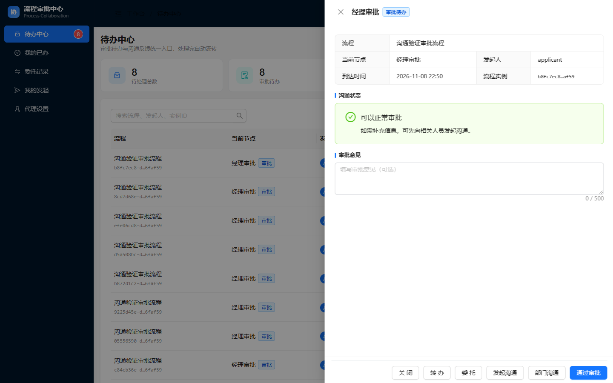
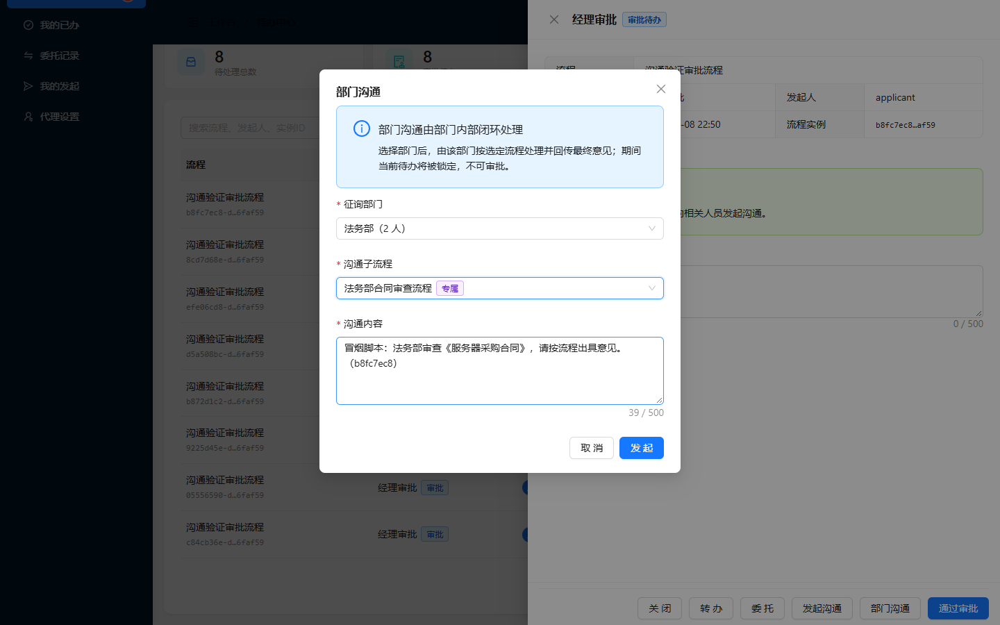
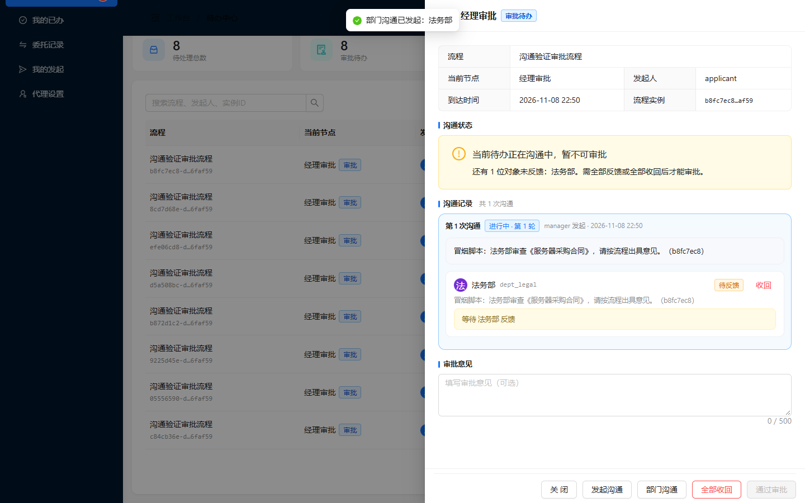
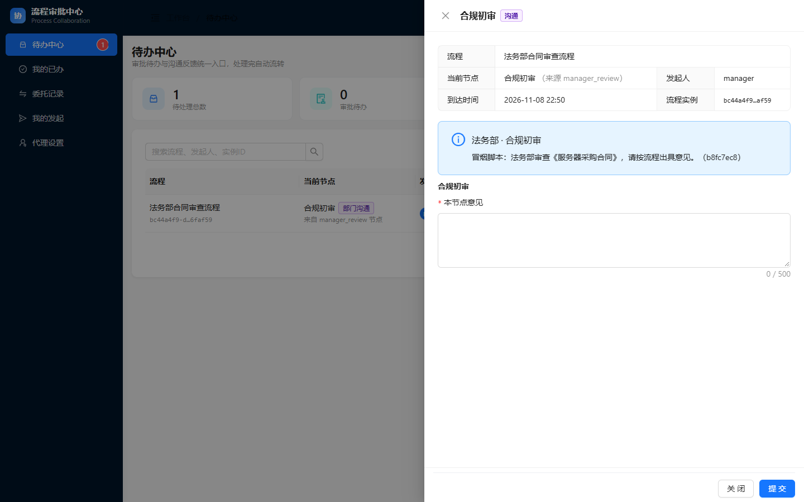
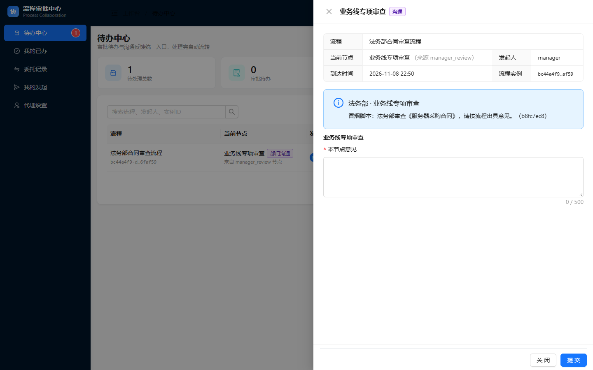
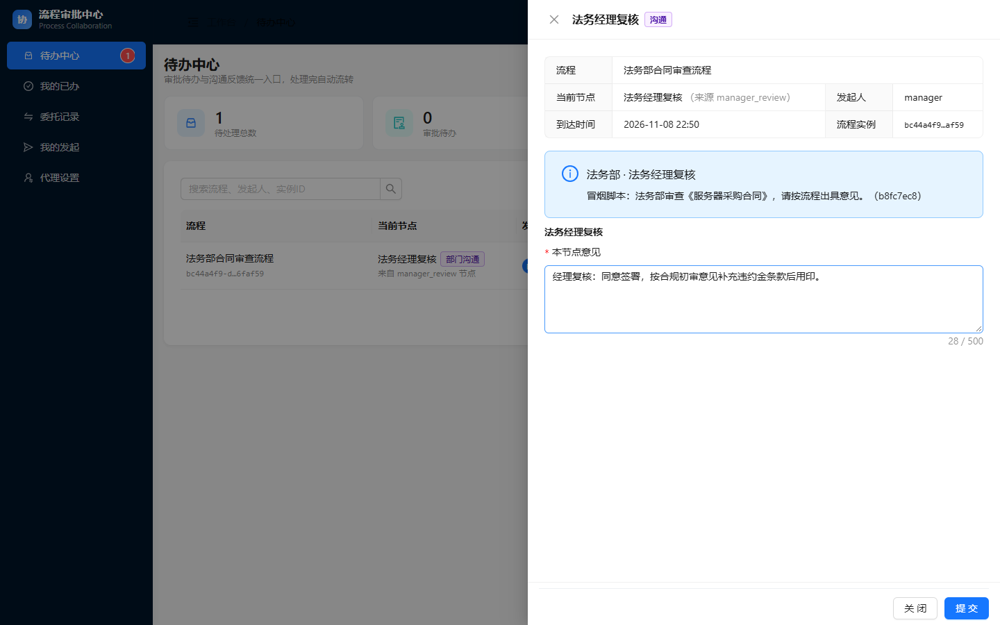
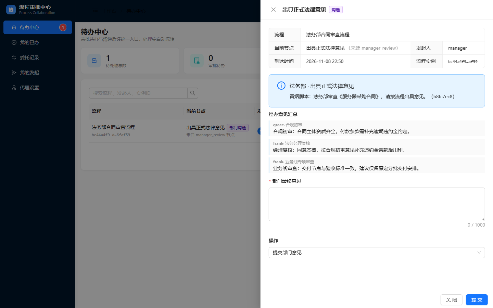
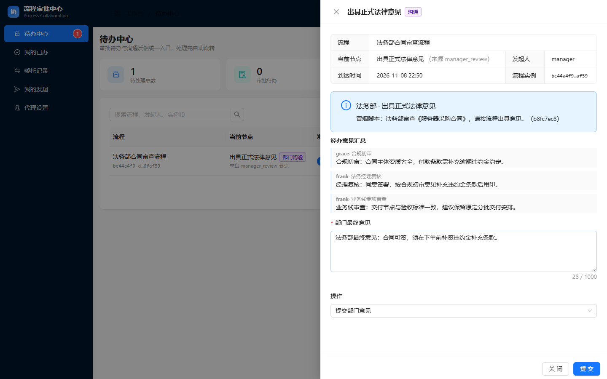
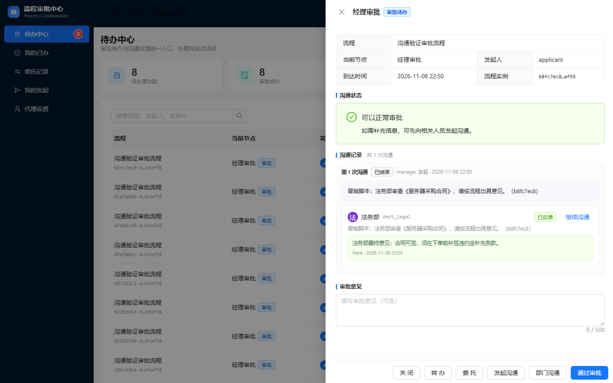

> **归档副本（2026-11-08）** — 本文件与 `reports-original/` 下同名文件内容一致；差异仅为图片引用：正文中 24 小时过期的 CDN 签名链接已替换为归档包内相对路径。
> 图片未复制副本，直接引用 `evidence/e2e-shots/` 下的脚本原始截图（已逐张做 SHA256 一致性校验）。
> 修订明细见 `MANIFEST.md` 第三节。

# 部门沟通 · 法务部合同审查子流程 过程验收报告

| 项目 | 内容 |
|---|---|
| 报告编号 | ACC-DEPT-COMM-002 |
| 被测对象 | 部门沟通功能 — 法务部专属子流程（`dept_comm_legal_contract`） |
| 测试类型 | 端到端真机冒烟（真实浏览器 + 真实 HTTP + 真实引擎） |
| 执行脚本 | `frontend/scripts/dept-comm-legal-smoke.mjs` |
| 执行环境 | localhost:8080 / H2 / 演示数据（`DemoUserInitializer`） |
| 步骤总数 | 14 步（11 个 UI 步骤 + 1 个汇总断言 + API 交叉验证） |
| 通过 / 失败 | **14 / 0** |
| 截图数量 | 12 张（`e2e-shots/dept-legal/`） |
| 报告结论 | **通过，`NODE` 分支已覆盖** |

---

## 一、验收目标与判定口径

专属流程与通用流程的本质差异：**"谁来办"写死在 BPMN 里，不经过文书运行时选人。**

```
合规初审 → 业务线专项审查 → 法务经理复核 → 经办意见汇总
 (legal_compliance) (legal_business)   (legal_manager)  (dept_legal_clerk)
```

本次要验证三件事：

1. 专属流程**只对法务部出现**，其他部门下拉里看不到；
2. 三个**固定岗位节点**（`isNode` 分支）各自能打开、能提交，走 `/node-opinion` 而非 `/opinion`；
3. 汇总节点能把三个节点的意见**按 nodeKey 串起来**（`opinionMap`），不是只汇总最后一条。

判定口径同报告 001：界面态 / 网络态 / 引擎态三者同时满足。

---

## 二、前置条件与账号

| 角色 | 账号 | 口令 | 岗位组 | 负责节点 |
|---|---|---|---|---|
| 审批人 | `manager` | `demo` | BPMN 写死 `assignee` | 发起、最终解锁 |
| 合规专员 | `grace` | `demo` | `dept_legal`、`legal_compliance` | 合规初审 |
| 法务专员（多岗） | `frank` | `demo` | `dept_legal`、`dept_legal_clerk`、`legal_business`、`legal_manager` | 业务线审查 / 经理复核 / 汇总 |

> **演示数据说明**：法务部只有两人，`frank` 一人挂了三个岗位，因此脚本中 `frank` 连续登录三次办理三个节点。这不是脚本取巧，而是 `DemoUserInitializer` 的组配置结果；真实组织里若三岗分三人，只需把三个节点各自对应到账号。

---

## 三、过程记录

### 步骤 1｜造数并打开经理待办

**操作**：API 启动申请流程 → 提交申请人节点 → 制造 `manager` 的「经理审批」待办；登录 `manager` 打开详情。

**实测**：待办正常列出，抽屉展示「经理审批」表单与沟通记录区。



**判定**：✅ 通过。

### 步骤 2｜打开部门沟通弹窗，选择法务部

**操作**：点「部门沟通」→ 部门下拉选「法务部」。

**实测**：弹窗打开后子流程下拉**刷新为法务部专属项**，出现「法务部合同审查流程」。

**验收点**：这是"部门专属"的可见性证据——同一弹窗在 IT 部下没有这一项（见报告 001 步骤 2 对照）。



**判定**：✅ 通过。

### 步骤 3｜发起专属流程，验证主待办锁定

**操作**：选中「法务部合同审查流程」，填沟通内容后提交。

**实测**：提示「部门沟通已发起：法务部」；主待办提示区变为「当前待办正在沟通中，暂不可审批」，「通过审批」disabled。



**判定**：✅ 通过。与通用流程一致，锁定逻辑不因流程类型分叉。

### 步骤 4｜`grace` 办理「合规初审」（NODE 分支第 1 岗）

**操作**：以 `grace` 登录 → 待办中心找到「合规初审」→ 打开面板 → 填意见 → 提交。

**实测**：面板标题「合规初审」，来源标注「法务部」；`POST /api/comm/dept-sub/{id}/node-opinion` → 200，界面提示「意见已提交」。

**意义**：走的是 `/node-opinion` 而不是 `/opinion`——这是专属流程与通用流程在接口层的第一处分叉点。




**判定**：✅ 通过。

### 步骤 5｜`frank` 办理「业务线专项审查」（NODE 分支第 2 岗）

**操作**：`frank` 登录 → 打开「业务线专项审查」面板 → 提交。

**实测**：面板标题「业务线专项审查」；`POST .../node-opinion` → 200。

**要点**：首节点办完后，流程**没有回到文书分发**，而是直接落到第二个固定岗位——这证明专属流程确实是 BPMN 串行编排，不是通用流程的变体。




**判定**：✅ 通过。

### 步骤 6｜`frank` 重新登录，办理「法务经理复核」（NODE 分支第 3 岗）

**操作**：同一账号需重新登录（前一会话已被新会话顶掉），打开「法务经理复核」面板 → 提交。

**实测**：面板标题「法务经理复核」；`POST .../node-opinion` → 200。




**判定**：✅ 通过。

### 步骤 7｜汇总节点：确认三段意见已串起来

**操作**：打开「经办意见汇总」面板（节点 key 以 `Summary` 结尾，`nodeType` 判为 `SUMMARY`）。

**实测断言**：脚本不只看"面板打开了"，而是**逐条断言**面板内同时出现三段意见原文：

| 断言项 | 期望 | 结果 |
|---|---|---|
| 合规初审意见 | 出现 | ✅ |
| 业务线专项审查意见 | 出现 | ✅ |
| 法务经理复核意见 | 出现 | ✅ |

**意义**：这是 `NODE` 分支最容易出问题的地方——节点意见写了但没进汇总面板，业务上等价于"白填"。



**判定**：✅ 通过。

### 步骤 8｜填写并提交法务部最终意见

**操作**：填最终意见 → 提交。

**实测**：`POST .../summary` → 200；响应「部门意见已提交，主流程待办已解锁」。



**判定**：✅ 通过。

### 步骤 9｜主待办解锁并回填法务意见

**操作**：`manager` 刷新待办。

**实测**：「通过审批」恢复可点；沟通记录区显示法务部最终意见。



**判定**：✅ 通过。

### 步骤 10｜API 交叉验证

```json
GET /api/comm/status/{taskId}  →  bizStatus = NORMAL
```

**判定**：✅ 通过。子流程实例结束，无残留。

---

## 四、过程中修复的脚本缺陷（非产品缺陷）

首轮执行 13/14，最后一步 API 校验返回：

```
✗ API 登录失败 manager: 401
```

**根因**：`makeApiSession()` 把 cookie 容器放在闭包外层，上一次登录的 `JSESSIONID` 会带到下一次请求，而那个会话已被 UI 登录顶掉，`ConcurrentSessionFilter` 直接返回 401，请求到不了登录逻辑——表现为"密码正确却 401"。

**修法**：每次 `login()` 内部新建 cookie jar。同一处隐患也同步修在 `dept-comm-smoke.mjs` 中（并重跑报告 001，12/12 通过）。

---

## 五、结论

**通过。** 14 步全部达成，`NODE` 分支（三个固定岗位节点）与 `SUMMARY` 分支（按 nodeKey 汇总）均在真实浏览器中验证：

- 专属流程按部门隔离显示；
- 三个岗位节点各自可见、可提交，走 `/node-opinion`；
- 汇总面板同时呈现三段节点意见，提交后主流程解锁；
- `bizStatus=NORMAL`。

---

## 六、遗留问题与风险（如实记录）

1. **只跑了法务这一条专属流程**，财务部预算审核见报告 003；三条流程共用同一套监听器与 `DeptSubTaskService`，但节点数与岗位不同。
2. **依赖演示岗位组**（`legal_compliance`、`legal_business`、`legal_manager`、`dept_legal_clerk`）。真实组织若某组无人，节点会停在无人认领处，脚本会在"打开某节点面板"这步失败——这是正确的失败方式。
3. **一人多岗是演示数据造成**：`frank` 三岗合一。真实组织三岗分三人时，需把三个节点各自映射到账号，中间的"重新登录"逻辑要改成三人各登录一次。
4. **未跑 `mvn test`**：本轮零后端改动，81 个用例状态未重新确认。
5. 仅验证 H2；脚本会写入真实数据，勿对生产库执行。

---

**编制**：自动化冒烟脚本 + 人工核对　|　**执行时间**：2026-11-08 14:50　|　**报告状态**：初版
