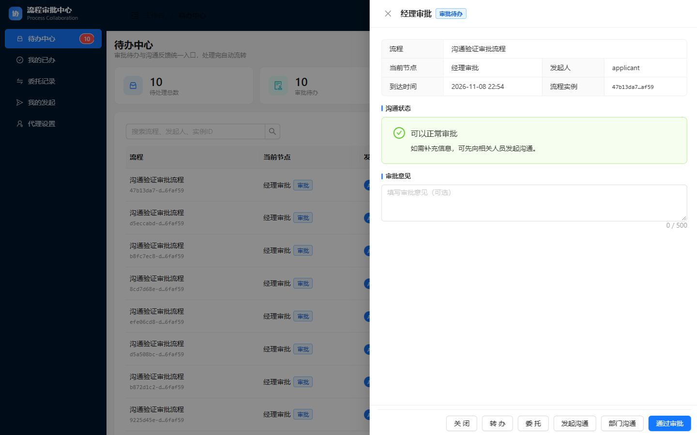
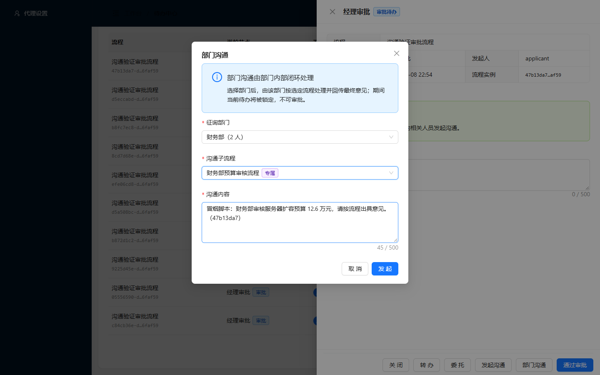
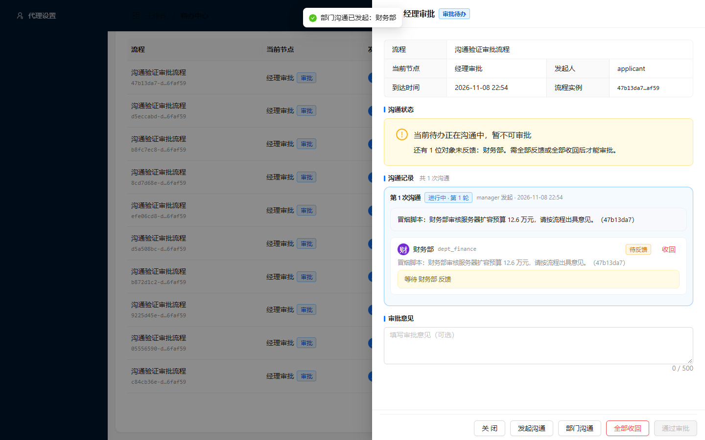
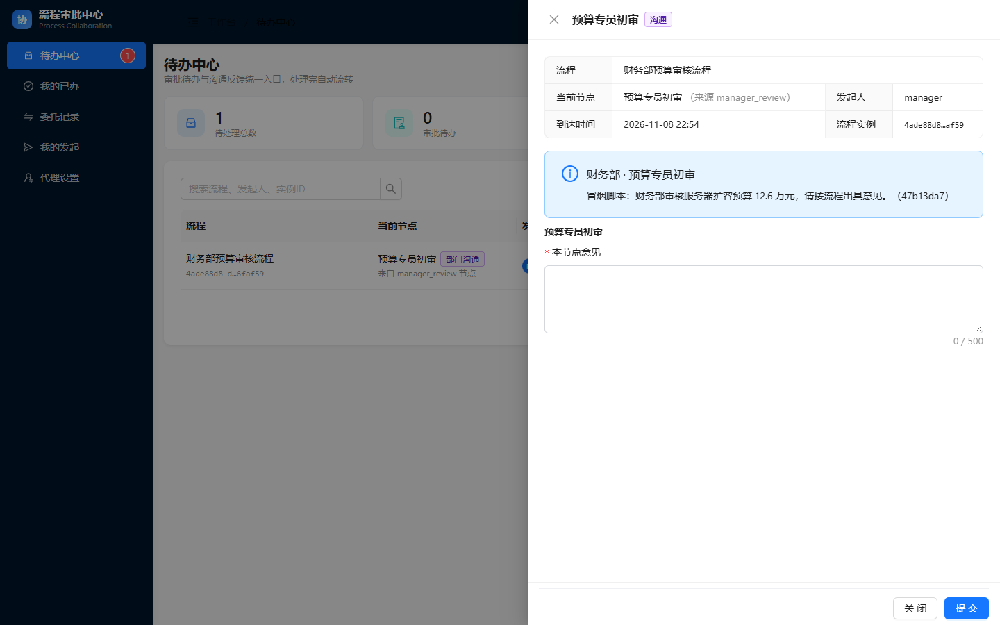
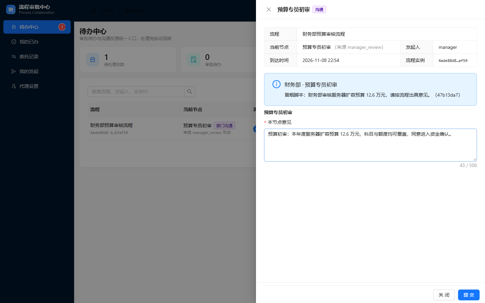
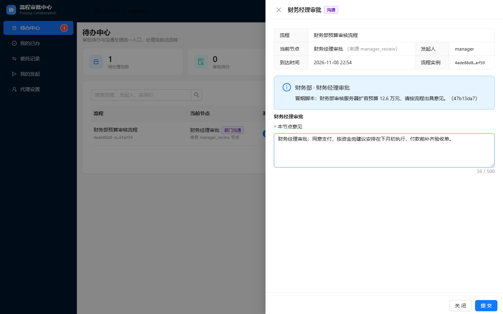
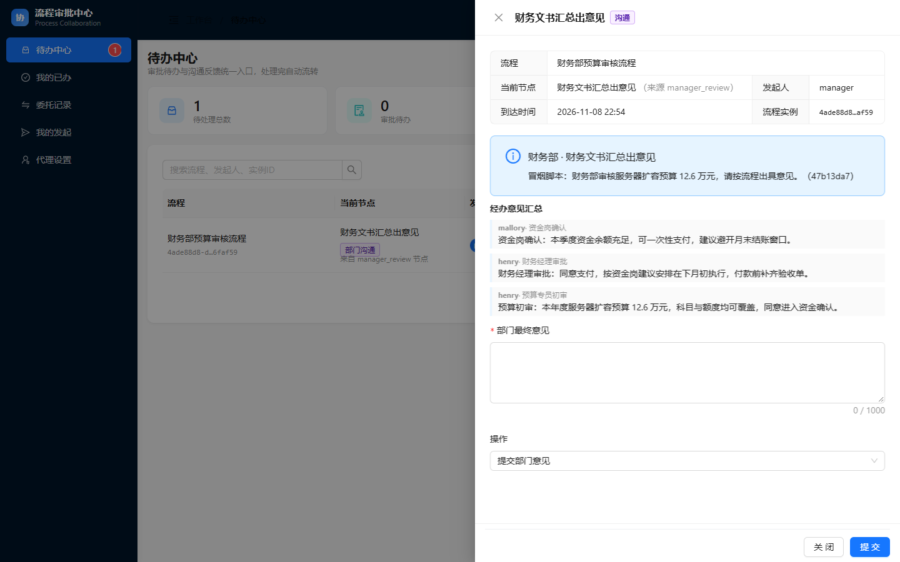
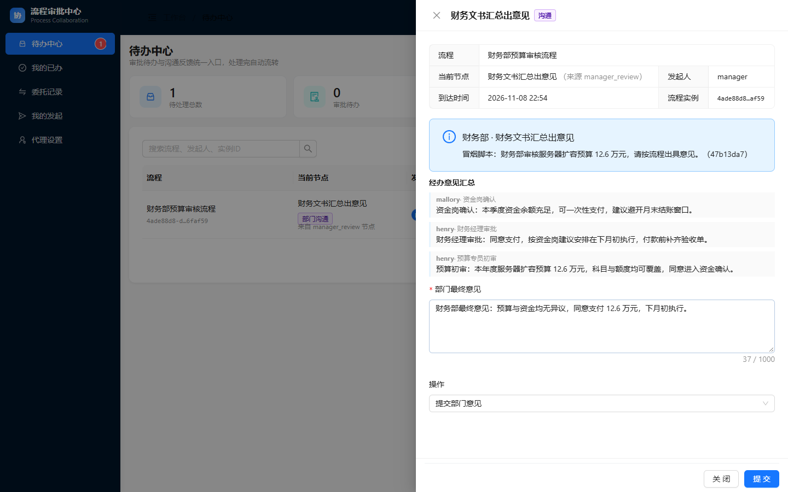
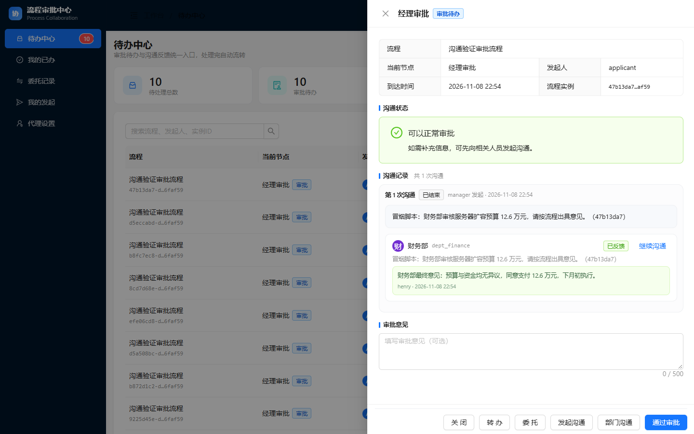

> **归档副本（2026-11-08）** — 本文件与 `reports-original/` 下同名文件内容一致；差异仅为图片引用：正文中 24 小时过期的 CDN 签名链接已替换为归档包内相对路径。
> 图片未复制副本，直接引用 `evidence/e2e-shots/` 下的脚本原始截图（已逐张做 SHA256 一致性校验）。
> 修订明细见 `MANIFEST.md` 第三节。

# 部门沟通 · 财务部预算审核子流程 过程验收报告

| 项目 | 内容 |
|---|---|
| 报告编号 | ACC-DEPT-COMM-003 |
| 被测对象 | 部门沟通功能 — 财务部专属子流程（`dept_comm_finance_budget`） |
| 测试类型 | 端到端真机冒烟（真实浏览器 + 真实 HTTP + 真实引擎） |
| 执行脚本 | `frontend/scripts/dept-comm-finance-smoke.mjs` |
| 执行环境 | localhost:8080 / H2 / 演示数据（`DemoUserInitializer`） |
| 步骤总数 | 14 步 |
| 通过 / 失败 | **14 / 0（一次通过）** |
| 截图数量 | 12 张（`e2e-shots/dept-finance/`） |
| 报告结论 | **通过。三条部门沟通链路至此全部覆盖** |

---

## 一、验收目标与判定口径

财务部是本轮三条流程中**节点数相对人数最多**的一条——3 个固定节点 + 汇总，而财务部只有 2 个人。

```
预算专员初审 → 资金岗确认 → 财务经理审批 → 经办意见汇总
(finance_budget) (finance_treasury) (finance_manager) (dept_finance_clerk)
```

本次要验证：

1. 弹窗中**只出现财务部专属流程**，不串到法务或通用；
2. 三个固定节点按 BPMN 顺序推进，`Task_FinanceBudget` → `Task_FinanceTreasury` → `Task_FinanceManager`；
3. 汇总面板能同时呈现**三段节点意见**（`opinionMap` 按 nodeKey 串联）；
4. 提交汇总后主流程解锁，`bizStatus` 回到 `NORMAL`。

判定口径同报告 001 / 002：界面态 / 网络态 / 引擎态三者同时满足。

---

## 二、前置条件与账号

| 角色 | 账号 | 口令 | 岗位组 | 负责节点 |
|---|---|---|---|---|
| 审批人 | `manager` | `demo` | BPMN 写死 `assignee` | 发起、最终解锁 |
| 预算专员 / 财务经理 / 文书 | `henry` | `demo` | `dept_finance_clerk`、`finance_budget`、`finance_manager` | 初审、经理审批、汇总 |
| 资金岗 | `mallory` | `demo` | `finance_treasury` | 资金岗确认 |

> **演示数据说明**：`henry` 一人挂三个岗位，因此脚本中 `henry` 登录三次。真实组织三岗分三人时，改 4 个环境变量（`SMOKE_BUDGET_USER`、`SMOKE_TREASURY_USER`、`SMOKE_FINANCE_MANAGER_USER`、`SMOKE_FINANCE_CLERK_USER`）即可，节点映射已参数化在 `NODES` 数组中。

---

## 三、过程记录

### 步骤 1｜造数并打开经理待办

**操作**：API 启动申请流程 → 提交申请人节点 → 制造 `manager` 的「经理审批」待办；登录 `manager` 打开详情。

**实测**：待办正常列出，抽屉展示「经理审批」表单。



**判定**：✅ 通过。

### 步骤 2｜选择「财务部 + 财务部预算审核流程」

**操作**：点「部门沟通」→ 部门选「财务部（2 人）」→ 子流程选「财务部预算审核流程」。

**实测**：下拉项为财务部专属项，与法务部、IT 部不重叠。



**判定**：✅ 通过。

### 步骤 3｜发起并验证主待办锁定

**操作**：提交发起。

**实测**：提示「部门沟通已发起：财务部」；主待办进入「正在沟通中，暂不可审批」，「通过审批」disabled。



**判定**：✅ 通过。

### 步骤 4｜`henry` 办理「预算专员初审」

**操作**：`henry` 登录 → 打开「预算专员初审」→ 填意见 → 提交。

**实测**：面板标题「预算专员初审」，来源「财务部」；`POST /api/comm/dept-sub/{id}/node-opinion` → 200。

**意见原文（脚本写入）**：预算初审：本年度服务器扩容预算 12.6 万元，科目与额度均可覆盖，同意进入资金确认。





**判定**：✅ 通过。

### 步骤 5｜`mallory` 办理「资金岗确认」

**操作**：`mallory` 登录 → 打开「资金岗确认」→ 提交。

**实测**：面板标题「资金岗确认」，当前节点标注「资金岗确认（来源 manager_finance_...）」，即流程确实从初审节点流转到资金岗；`POST .../node-opinion` → 200。


**判定**：✅ 通过。**换人办理成功**，说明固定岗位按组分配生效（不是写死单个用户）。

### 步骤 6｜`henry` 办理「财务经理审批」

**操作**：`henry` 重新登录 → 打开「财务经理审批」→ 提交。

**实测**：面板标题「财务经理审批」；`POST .../node-opinion` → 200。




**判定**：✅ 通过。

### 步骤 7｜汇总节点：三段意见齐备性断言

**操作**：打开「经办意见汇总」面板。

**实测断言**（脚本逐条核对面板文本）：

| 断言项 | 期望 | 结果 |
|---|---|---|
| 预算专员初审意见 | 出现 | ✅ |
| 资金岗确认意见 | 出现 | ✅ |
| 财务经理审批意见 | 出现 | ✅ |

**意义**：只有三段都在，`opinionMap` 才算真正按 nodeKey 串起来；缺任何一条业务上都是"意见丢失"。



**判定**：✅ 通过。

### 步骤 8｜提交财务部最终意见

**操作**：填最终意见 → 提交。

**实测**：`POST .../summary` → 200；响应「部门意见已提交，主流程待办已解锁」。



**判定**：✅ 通过。

### 步骤 9｜主待办解锁并回填财务意见

**操作**：`manager` 刷新待办。

**实测**：「通过审批」恢复可点；沟通记录区显示财务部最终意见。



**判定**：✅ 通过。

### 步骤 10｜API 交叉验证

```json
GET /api/comm/status/{taskId}  →  bizStatus = NORMAL
```

**判定**：✅ 通过。

---

## 四、本脚本相对法务脚本的两处改动

| 改动 | 原因 |
|---|---|
| 待办遍历上限 8 → 12 条 | `henry` 挂三个组，历史待办比 `frank` 多，8 条会漏掉本次待办 |
| 三个 NODE 节点收成 `NODES` 数组循环办理 | 标题 / 组 / 账号 / 意见集中一处，换真实组织时只改数组与 4 个环境变量 |

其余逻辑（会话隔离、标记位定位、汇总断言）与法务脚本完全一致——**两条专属流程共用同一套代码路径**。

---

## 五、三条流程横向对照

| 维度 | 通用（IT 部） | 法务部 | 财务部 |
|---|---|---|---|
| process id | `dept_comm_general` | `dept_comm_legal_contract` | `dept_comm_finance_budget` |
| 适用部门 | 全部门 | `dept_legal` | `dept_finance` |
| 事项类型 | `GENERAL` | `CONTRACT` | `BUDGET` |
| 节点数 | 分发 → 经办 → 汇总（3） | 4 | 4 |
| 选人方式 | 文书运行时选 | BPMN 写死组 | BPMN 写死组 |
| 可否退回补充 | 可以 | 否 | 否 |
| 验收结果 | 12/12 | 14/14 | **14/14** |

一句话概括：**专属流程把"谁来办"写进 BPMN，通用流程把"谁来办"交给文书在运行时选。** 除此之外三者共用同一套监听器与 `DeptSubTaskService`，业务代码零分叉。

---

## 六、结论

**通过，且一次跑通。** 财务链路的 14 步全部达成：

- 专属流程按部门隔离显示；
- 三个固定节点按 BPMN 顺序推进，跨账号办理成功；
- 汇总面板三段意见齐备，提交后主流程解锁；
- `bizStatus=NORMAL`。

---

## 七、遗留问题与风险（如实记录）

1. **岗位组配人比脚本更容易出问题**：财务部只有 2 人却是节点最多的一条，任一组为空，节点会停在无人认领处，脚本会在"打开某节点面板"这步失败（正确失败方式，非脚本缺陷）。
2. **仅验证 H2 + 演示账号**，其他数据库方言未涉及。
3. **脚本会写入真实数据**（1 条申请流程 + 1 条部门沟通子流程），演示库可丢弃，生产库不可执行。
4. **未跑 `mvn test`**：本轮零后端改动，81 个用例状态未重新确认。
5. 未跑 `SMOKE_HEADED=1` 有头模式，仅无头执行。

---

**编制**：自动化冒烟脚本 + 人工核对　|　**执行时间**：2026-11-08 14:54　|　**报告状态**：初版
