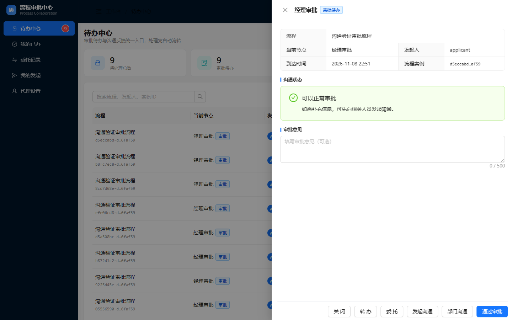
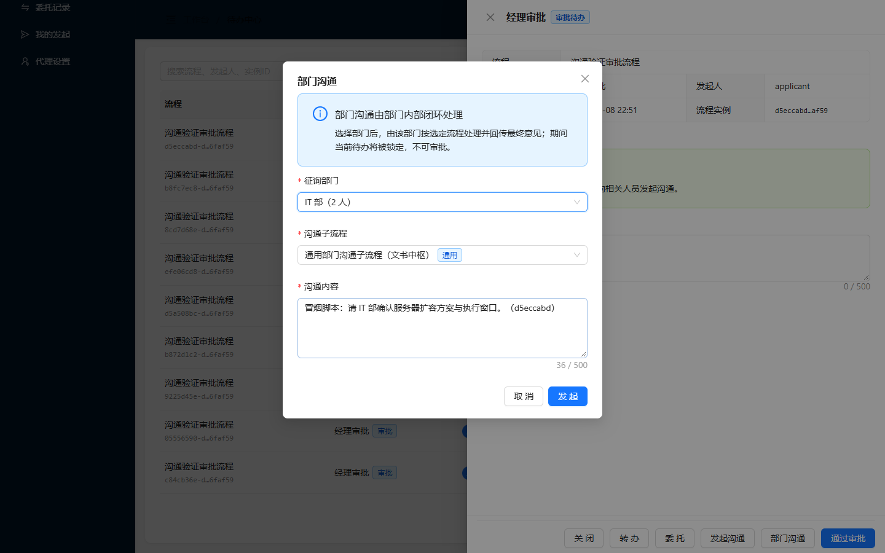
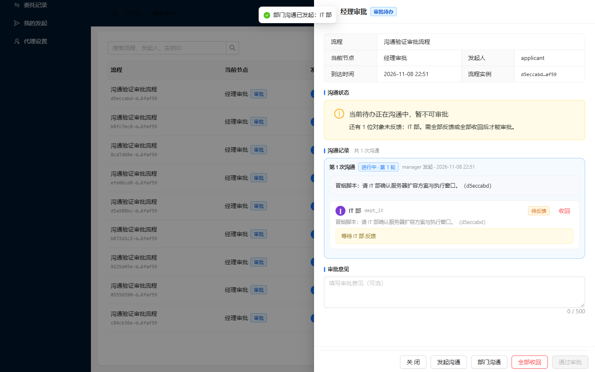
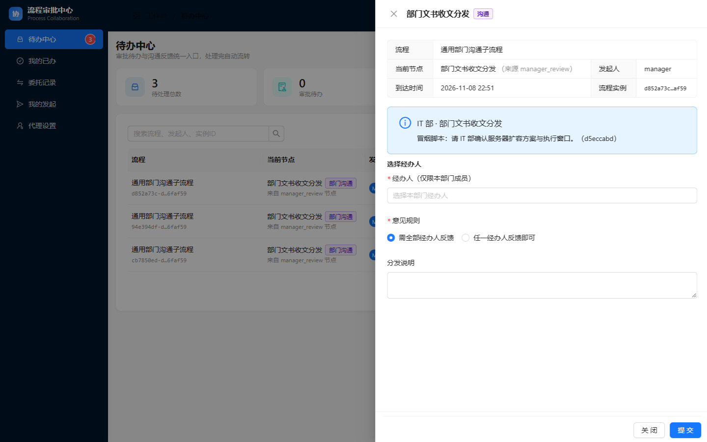
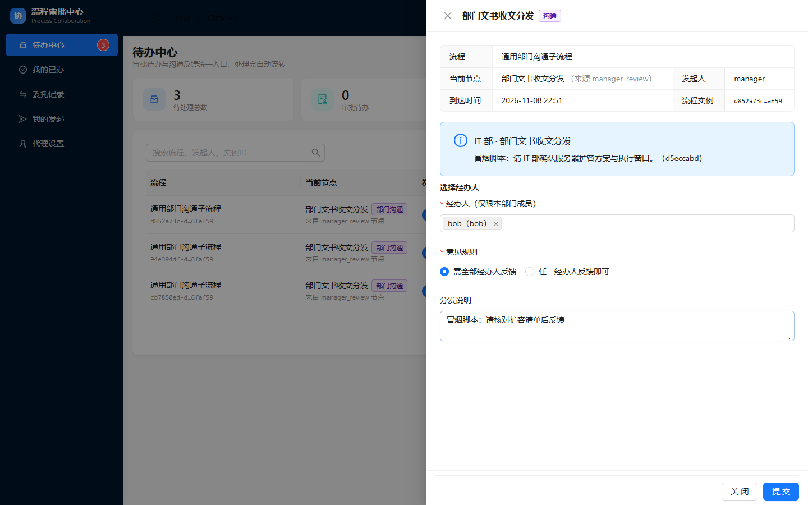
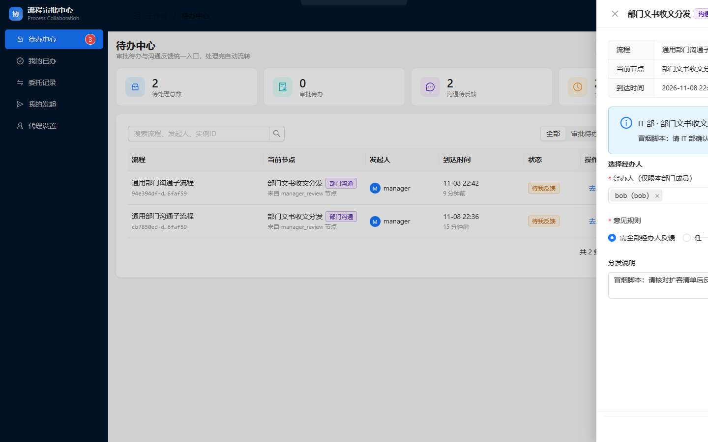
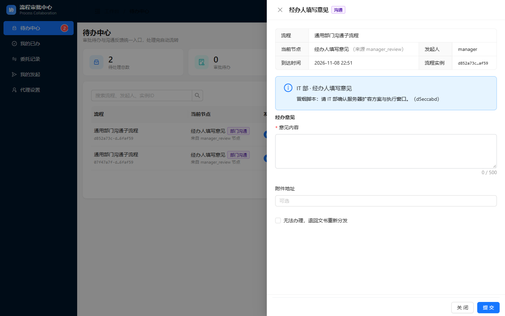
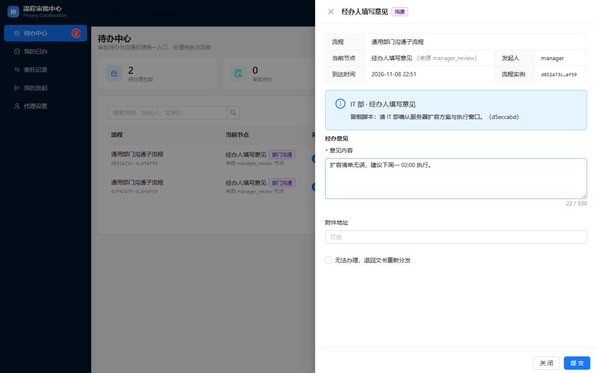
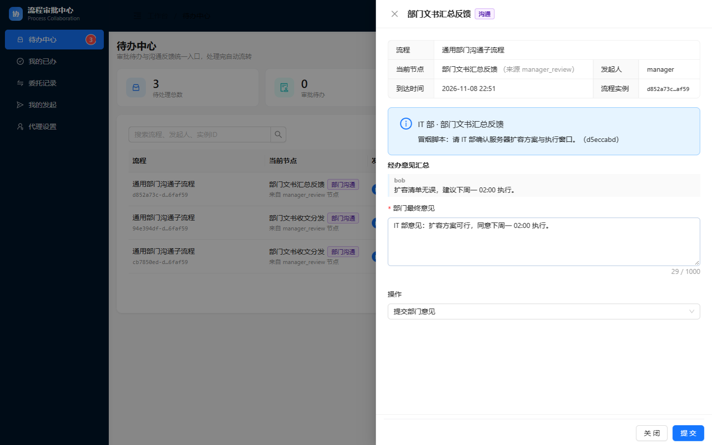
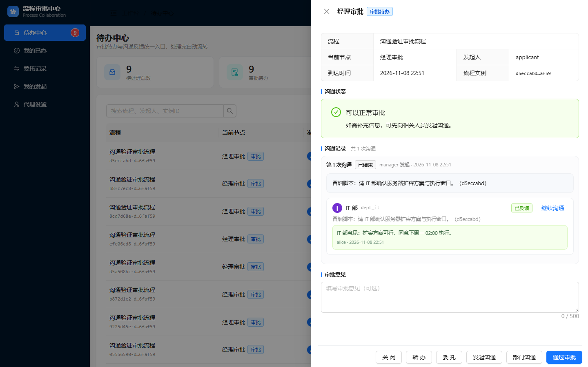

> **归档副本（2026-11-08）** — 本文件与 `reports-original/` 下同名文件内容一致；差异仅为图片引用：正文中 24 小时过期的 CDN 签名链接已替换为归档包内相对路径。
> 图片未复制副本，直接引用 `evidence/e2e-shots/` 下的脚本原始截图（已逐张做 SHA256 一致性校验）。
> 修订明细见 `MANIFEST.md` 第三节。

# 部门沟通 · 通用子流程 过程验收报告

| 项目 | 内容 |
|---|---|
| 报告编号 | ACC-DEPT-COMM-001 |
| 被测对象 | 部门沟通功能 — 通用部门子流程（`dept_comm_general`） |
| 测试类型 | 端到端真机冒烟（真实浏览器 + 真实 HTTP + 真实引擎） |
| 执行脚本 | `frontend/scripts/dept-comm-smoke.mjs` |
| 执行环境 | localhost:8080 / H2 / 演示数据（`DemoUserInitializer`） |
| 步骤总数 | 12 步（含 1 步 API 交叉验证） |
| 通过 / 失败 | **12 / 0** |
| 截图数量 | 11 张（`e2e-shots/dept-comm/`） |
| 报告结论 | **通过，可进入下一阶段验收** |

---

## 一、验收目标与判定口径

本次验收要证明的不是"接口能返回 200"，而是一条完整业务闭环：

**经理发起部门沟通 → 主待办被锁定 → 部门文书分发 → 经办人填意见 → 文书汇总 → 部门意见回填 → 主待办解锁。**

判定口径（三项同时满足才计为通过）：

1. **界面态**：页面上按钮/面板真实存在，状态符合预期（禁用、出现、回填）；
2. **网络态**：写操作必须有对应 `POST` 且返回 HTTP 200，请求体字段正确；
3. **引擎态**：子流程实例结束、`bizStatus` 回到 `NORMAL`，不靠界面文字自证。

> 所有"实测"结论均来自浏览器点击与接口响应，不是单元测试断言。

---

## 二、前置条件与账号

| 角色 | 账号 | 口令 | 归属 | 流程职责 |
|---|---|---|---|---|
| 申请人 | `applicant` | `demo` | — | 通过 `/api/comm/demo/start` 造业务数据 |
| 审批人 | `manager` | `demo` | BPMN 写死 `assignee` | 发起沟通、最终审批 |
| 部门文书 | `alice` | `demo` | `dept_it_clerk` | 分发、汇总 |
| 经办人 | `bob` | `demo` | `dept_it` | 提交经办意见 |

前置条件：应用已启动、`dept_comm_general` 已部署、前端为最新构建（需 Ctrl+F5 强刷）、演示库可用（本脚本写真实数据，勿对生产库执行）。

---

## 三、过程记录

### 步骤 1｜造数并定位待办

**操作**：API 启动一条申请流程并提交申请人节点，制造一条落在 `manager` 的「经理审批」待办。

**实测**：实例创建成功；脚本把实例短 ID 前 8 位写入沟通内容作为标记位，供后续三步精确定位"本次"的子任务，避免被历史数据串扰。



**判定**：✅ 通过。待办出现在「待办中心」，当前节点「经理审批」。

### 步骤 2｜打开「部门沟通」弹窗

**操作**：在待办抽屉底部点击「部门沟通」。

**实测**：弹窗正常打开，含「部门」「子流程」两个下拉与沟通内容输入框。

**要点**：选部门后子流程下拉**按部门过滤**——IT 部只出现「通用部门沟通子流程」，不会出现法务、财务的专属流程。



**判定**：✅ 通过。下拉项与部门注册表一致。

### 步骤 3｜选中「IT 部 + 通用部门沟通子流程」并发起

**操作**：部门选「IT 部（2 人）」，子流程选「通用部门沟通子流程」，填沟通内容后提交。

**实测**：界面提示「部门沟通已发起：IT 部」；沟通记录区新增卡片，标注「IT 部」与「部门沟通中」；`POST /api/comm/dept-sub/...` → 200。



**判定**：✅ 通过。

### 步骤 4｜验证主待办进入锁定态

**操作**：观察沟通发起后的待办详情页。

**实测**：提示区显示「当前待办正在沟通中，暂不可审批」；「通过审批」按钮变为 disabled；「转办」同步不可用；底部仍保留「发起沟通」「部门沟通」入口。

**意义**：这是**并发冲突防护**的关键点——部门还在办，主流程不能被单方面推走。


**判定**：✅ 通过（`disabled` 由脚本读取 DOM 属性确认，非目测）。

### 步骤 5｜文书 `alice` 打开分发表单

**操作**：以 `alice` 登录（独立 browser context，避免与 manager 会话互踢），在待办中心找到「部门文书收发分发」待办并打开。

**实测**：面板标题「部门文书收发分发」，来源标注「IT 部」，提供经办人多选、经办范围单选（全部 / 任一经办人）、分发说明。



**判定**：✅ 通过。

### 步骤 6｜选择 `bob` 并提交分发

**操作**：经办人下拉选中 `bob`（界面显示「bob（bob）」标签），经办范围选「全部经办人反馈」，填说明后提交。

**实测**：`POST /api/comm/dept-sub/{id}/dispatch` → 200，请求体 `{"handlerUserIds":["bob"],"opinionRule":"ALL","remark":"..."}`；界面提示「已分发，经办人待办已生成」。





**判定**：✅ 通过。**本步曾失败**：脚本用 `Escape` 收 antd 多选下拉，而 `Drawer` 的 `keyboard` 默认 `true`，`Escape` 关掉的是整个抽屉。已改为点击面板空白区，修复后一次通过。

### 步骤 7｜经办人 `bob` 填写意见

**操作**：`bob` 登录 → 打开「经办意见」面板 → 填写 → 提交。

**实测**：`POST /api/comm/dept-sub/{id}/opinion` → 200，响应 `{"result":"ok","message":"意见已提交"}`；提交后表单转只读态。





**判定**：✅ 通过。

### 步骤 8｜文书 `alice` 汇总

**操作**：`alice` 刷新待办，打开「经办意见汇总」面板，确认面板内出现 `bob` 的意见原文，再填部门最终意见并提交。

**实测**：`POST /api/comm/dept-sub/{id}/summary` → 200，请求体 `{"finalOpinion":"...","actionType":"SUBMIT"}`；响应「部门意见已提交，主流程待办已解锁」。




**判定**：✅ 通过。汇总内容确实取自 `opinionMap`，不是重新手填。

### 步骤 9｜主待办解锁并回填意见

**操作**：`manager` 刷新待办，观察详情页。

**实测**：提示区恢复「可以正常审批」；「通过审批」按钮恢复可点；沟通记录卡片内显示 IT 部最终意见与聊天式往返记录。



**判定**：✅ 通过。

### 步骤 10｜关浏览器后 API 交叉验证

**操作**：关闭浏览器（避免同账号二次登录互踢），新建会话重新登录，直查业务状态。

```json
GET /api/comm/status/{taskId}  →  bizStatus = NORMAL
```

**判定**：✅ 通过。引擎侧无残留子流程实例，主流程状态干净。

---

## 四、证据汇总

| 环节 | 接口 | 结果 |
|---|---|---|
| 发起沟通 | `POST /api/comm/dept-sub/start` | 200，子流程实例创建 |
| 分发 | `POST .../dispatch` | 200，`opinionRule=ALL` |
| 经办意见 | `POST .../opinion` | 200，`result=ok` |
| 汇总 | `POST .../summary` | 200，主流程解锁 |
| 状态核对 | `GET /api/comm/status/{taskId}` | `NORMAL` |

---

## 五、结论

**通过。** 12 步全部按预期执行，三项判定口径同时满足：

- 按钮、面板、锁定与解锁态均真实可见；
- 4 个写接口全部 200，请求体字段正确；
- 子流程正常结束，`bizStatus=NORMAL`。

---

## 六、遗留问题与风险（如实记录）

1. **仅覆盖 H2 + 演示账号**，其他数据库方言未验证。
2. **脚本会写入真实数据**（1 条申请流程 + 1 条部门沟通子流程），请勿对生产库执行。
3. **文书解析规则**为 `<deptId>_clerk` 组第一位成员，组为空时回退部门第一位成员。生产环境建议强制配置文书组，否则意见可能落到不合适的人身上。
4. **同账号二次登录会顶掉旧会话**（`ConcurrentSessionFilter` 返回 401）。非缺陷，但"UI 登录 + API 查询"必须在同一账号的不同时刻进行。
5. 本轮**未重跑后端 `mvn test`**（81 个用例），本报告只证明前端链路。

---

**编制**：自动化冒烟脚本 + 人工核对　|　**执行时间**：2026-11-08 14:51　|　**报告状态**：初版
